 

---

### 👨‍💻 Sobre mí

- 🧭 **Jefe de equipo** en [ING Asesoría Empresarial](https://github.com/INGAE2026), firma contable, tributaria y legal de Ecuador.
- 🏗️ Lidero el desarrollo del **Sistema INGAE**: automatización contable y tributaria que cuadra cada comprobante al centavo.
- 🔐 Me importa que lo que construimos sea **seguro** y funcione igual de bien en el celular que en la computadora.
- 📍 Ecuador.

 

### 🚀 En qué estoy trabajando

<table>
  <tr>
    <td width="33%" valign="top">
      <b>🧾 Sistema INGAE</b> 
      Comprobantes electrónicos del SRI, cruce de compras, ventas y retenciones, control de obligaciones y nómina.
    </td>
    <td width="33%" valign="top">
      <b>🧩 Extensión SRI</b> 
      Extensión de Chrome que trae los comprobantes del portal del SRI directo al sistema.
    </td>
    <td width="33%" valign="top">
      <b>🌐 <a href="https://www.ingae.org">ingae.org</a></b> 
      Sitio institucional bilingüe de la firma.
    </td>
  </tr>
</table>

🔒 Los repositorios del sistema son privados de la empresa.

 

### 🛠️ Herramientas

  
  
  
  
  
  
  
  
  
  
  

---

  «Cada centavo es una diferencia.» · Ing. Dereck Castro

